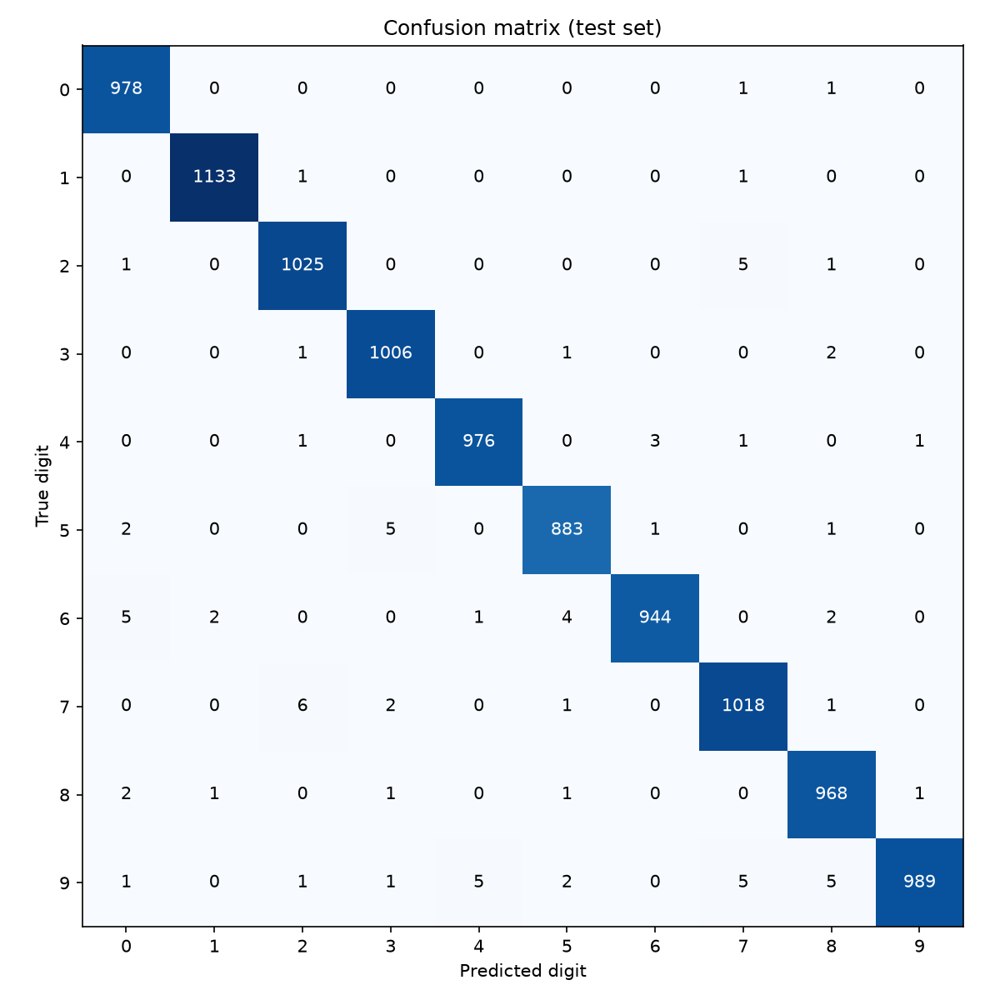

# MNIST Handwritten Digit Classifier

A convolutional neural network (CNN) built with PyTorch that recognizes handwritten digits (0–9) from the MNIST dataset, reaching **99.20% accuracy** on the test set.

This project was built as a foundation for a larger multilingual handwriting recognition project, with a focus on clean structure, reproducibility, and honest evaluation.

## Results

| Split | Images | Accuracy |
|---|---|---|
| Validation | 5,000 | 99.12% |
| Test | 10,000 | **99.20%** |

The test accuracy closely matches the validation accuracy, showing that the model generalizes well to unseen handwriting.

Accuracy per digit on the test set ranges from 98.02% (digit 9, the hardest) to 99.82% (digit 1, the easiest).



## Model architecture

A small CNN with about 422,000 trainable parameters:

```
Input (1×28×28)
→ Conv2d (32 filters, 3×3) → ReLU → MaxPool (2×2)    → 32×14×14
→ Conv2d (64 filters, 3×3) → ReLU → MaxPool (2×2)    → 64×7×7
→ Flatten → Linear (128) → ReLU → Dropout (0.25)
→ Linear (10)                                         → one score per digit
```

## Project structure

```
mnist-classifier/
├── configs/
│   └── config.yaml      # all settings (data, model, training, evaluation)
├── src/
│   ├── data.py          # loads MNIST and splits it into train/validation/test
│   ├── model.py         # the CNN definition
│   ├── train.py         # training loop; saves the best model by validation accuracy
│   ├── evaluate.py      # tests the best model and builds a confusion matrix
│   └── utils.py         # seed and device helpers
├── assets/              # images shown in this README
└── requirements.txt     # exact library versions
```

## Setup

Requirements: Python 3.14 and, for GPU training, an NVIDIA GPU with a driver supporting CUDA 13.2 or newer.

```
git clone https://github.com/TapadiptaRoy/mnist-classifier.git
cd mnist-classifier
python -m venv .venv
.venv\Scripts\Activate.ps1
pip install -r requirements.txt
```

The commands above are for Windows PowerShell. On macOS or Linux, activate the environment with `source .venv/bin/activate` instead.

## Usage

All commands are run from the main project folder.

**Train the model** (downloads MNIST automatically on the first run):

```
python -m src.train
```

**Evaluate on the test set** (prints accuracy and saves a confusion matrix to `outputs/`):

```
python -m src.evaluate
```

All settings, such as batch size, learning rate, and number of epochs, can be changed in `configs/config.yaml`.

## Reproducibility

A fixed random seed (set in `config.yaml`) controls the data split, weight initialization, and shuffling, so repeated runs produce the same results.

## Training details

| Setting | Value |
|---|---|
| Optimizer | Adam |
| Learning rate | 0.001 |
| Batch size | 64 |
| Epochs | 5 |
| Loss function | Cross-entropy |
| Training hardware | NVIDIA GeForce RTX 3060 |